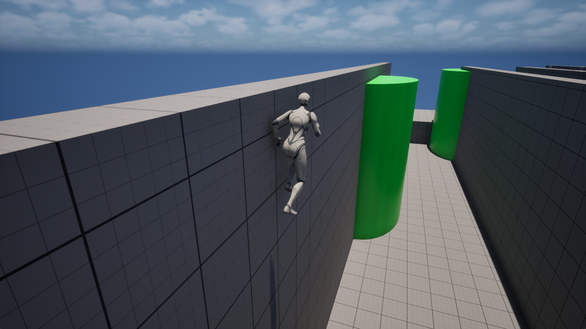

# UE5 C++ Wall Running System

A modular, performant wall running and wall jumping system in C++ for Unreal Engine 5.8. Pick one of two setups: a standalone actor component, or a Gameplay Ability System ability. Both share the same core logic and the same Animation Blueprint integration.

Animations are not included. The Animation Blueprint setup is covered in the [Animation Setup Guide](#animation-setup-guide).

## On this page

1. [Setup Guide](#setup-guide)
2. [Animation Setup Guide](#animation-setup-guide)
3. [FAQ](#faq)
4. [Extras](#extras)
   - [Configuration](#configuration)
   - [License](#license)

## Setup Guide

Full guide: [docs/setup-guide.md](docs/setup-guide.md)

Do the common installation first, then follow one setup.

| Step | Where |
| :--- | :--- |
| Requirements | [Requirements](docs/setup-guide.md#requirements) |
| Copy the source files | [Copy the source files](docs/setup-guide.md#copy-the-source-files) |
| Build.cs modules | [Update Build.cs](docs/setup-guide.md#update-buildcs) |
| Plugin in the .uproject | [Update your .uproject](docs/setup-guide.md#update-your-uproject) |
| Rename the API macro | [Rename the API macro](docs/setup-guide.md#rename-the-api-macro) |
| Build | [Rebuild](docs/setup-guide.md#rebuild) |
| Choose a setup | [Choose your setup](docs/setup-guide.md#choose-your-setup) |

Then pick one:

| | [Component setup](docs/setup-component.md) | [GAS setup](docs/setup-gas.md) |
| :--- | :--- | :--- |
| Core class | `UWallRunComponent` | `UGA_WallRun` |
| Needs an Ability System Component | No | Yes |
| State exposed as gameplay tags | Only if the character has an ASC | Yes |
| Block wall running from other systems | Your own checks | Tag `Status.BlockingAction.WallRun` |
| Best for | Most projects, quickest to set up | Projects already built on GAS |

Not sure? Start with the [Component setup](docs/setup-component.md).

**Component setup sections:** [included character](docs/setup-component.md#path-a-use-the-included-character), [your own character](docs/setup-component.md#path-b-add-it-to-your-own-character), [tune the settings](docs/setup-component.md#tune-the-settings), [mark walls](docs/setup-component.md#mark-which-walls-can-be-run-on), [events](docs/setup-component.md#listen-to-events), [check it works](docs/setup-component.md#check-it-works), [troubleshooting](docs/setup-component.md#troubleshooting)

**GAS setup sections:** [included character](docs/setup-gas.md#path-a-use-the-included-character), [your own character](docs/setup-gas.md#path-b-add-it-to-your-own-character), [gameplay tags](docs/setup-gas.md#gameplay-tags), [block with tags](docs/setup-gas.md#block-wall-running-with-tags), [tune the settings](docs/setup-gas.md#tune-the-settings), [check it works](docs/setup-gas.md#check-it-works), [troubleshooting](docs/setup-gas.md#troubleshooting)

## Animation Setup Guide

Full guide: [docs/animation-setup-guide.md](docs/animation-setup-guide.md)

All animation is handled in your Animation Blueprint, so wall running blends like any other locomotion state.

- [Reparent your Anim Blueprint](docs/animation-setup-guide.md#reparent-your-anim-blueprint)
- [Available variables](docs/animation-setup-guide.md#available-variables)
- [Set up the state machine](docs/animation-setup-guide.md#set-up-the-state-machine)
- [Disable Foot IK while wall running](docs/animation-setup-guide.md#disable-foot-ik-while-wall-running)
- [Procedural lean and spine tilt](docs/animation-setup-guide.md#procedural-lean-and-spine-tilt)
- [Using your own AnimInstance](docs/animation-setup-guide.md#using-your-own-animinstance)

## FAQ

Full FAQ: [docs/faq.md](docs/faq.md)

- [Component or GAS?](docs/faq.md#component-or-gas)
- [Do I need GAS if I pick the component?](docs/faq.md#do-i-need-gas-if-i-pick-the-component)
- [Why does the wall run not start?](docs/faq.md#why-does-the-wall-run-not-start)
- [Why can I not steer while wall running?](docs/faq.md#why-can-i-not-steer-while-wall-running)
- [How do I allow or block specific walls?](docs/faq.md#how-do-i-allow-or-block-specific-walls)
- [What does the corner angle limit do?](docs/faq.md#what-does-the-corner-angle-limit-do)
- [My character does not play any wall run animation](docs/faq.md#my-character-does-not-play-any-wall-run-animation)
- [Does it work in a packaged build?](docs/faq.md#does-it-work-in-a-packaged-build)

## Extras

### Configuration

Full reference: [docs/configuration.md](docs/configuration.md)

[General](docs/configuration.md#general), [collision](docs/configuration.md#collision), [corners](docs/configuration.md#corners), [movement](docs/configuration.md#movement), [wall jump](docs/configuration.md#wall-jump), [visuals](docs/configuration.md#visuals), [runtime state](docs/configuration.md#runtime-state)

### License

See [LICENSE.md](LICENSE.md).
